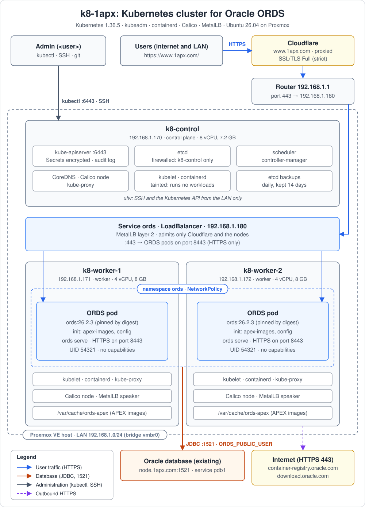

# k8-control: Ubuntu post-install changes

Changes made to the host `k8-control` (Ubuntu 26.04.1 LTS) after installation, on 2026-10-15.

`<user>` stands for your personal login on k8-control. The scripts that need it set it near their top: `USER_NAME` in `apply-changes.sh` and `revert-changes.sh`, `KUBECONFIG_USERS` in `control-plane-init.sh`, `CONTROL_LOGIN` in `proxmox-create-workers.sh` and `TARGETS` in `claude-classic-tui.sh`. `ci/validate.sh` checks they agree.

## Contents

- [Changes made after installation](#changes-made-after-installation)
- [Apply all changes](#apply-all-changes)
- [Revert all changes](#revert-all-changes)
- [Kubernetes cluster for Oracle ORDS](#kubernetes-cluster-for-oracle-ords)
  - [Cluster design](#cluster-design)
  - [Accounts](#accounts)
  - [DNS](#dns)
  - [Kernel settings](#kernel-settings)
  - [Firewall](#firewall)
  - [Public access through Cloudflare](#public-access-through-cloudflare)
  - [DNS records to add](#dns-records-to-add)
  - [Before you start](#before-you-start)
  - [Step 1: Create the admin account (on k8-control)](#step-1-create-the-admin-account-on-k8-control)
  - [Step 2: Create the worker VMs (on the Proxmox host)](#step-2-create-the-worker-vms-on-the-proxmox-host)
  - [Step 3: Prepare k8-control](#step-3-prepare-k8-control)
  - [Step 4: Create the control plane](#step-4-create-the-control-plane)
  - [Step 5: Join the workers](#step-5-join-the-workers)
  - [Step 6: Install the add-ons](#step-6-install-the-add-ons)
  - [Step 7: Deploy ORDS](#step-7-deploy-ords)
  - [Step 8: Check the cluster](#step-8-check-the-cluster)
  - [Running the cluster](#running-the-cluster)
- [Validation and CI](#validation-and-ci)
- [GitHub access](#github-access)
  - [One-time setup](#one-time-setup)
- [Appendix A: Copying text from Claude Code](#appendix-a-copying-text-from-claude-code)
- [Appendix B: ORDS on Kubernetes: security, operations and troubleshooting](#appendix-b-ords-on-kubernetes-security-operations-and-troubleshooting)
  - [B.1 Security practices applied](#b1-security-practices-applied)
  - [B.2 Day-to-day operations](#b2-day-to-day-operations)
  - [B.3 Troubleshooting](#b3-troubleshooting)
  - [B.4 Changing the number of ORDS pods](#b4-changing-the-number-of-ords-pods)

## Changes made after installation

| # | Change | File |
|---|--------|------|
| 1 | Passwordless sudo for `<user>` | `/etc/sudoers.d/<user>-nopasswd` (root:root, `0440`) |
| 2 | Static IP `192.168.1.170/24` on `ens18`, gateway `192.168.1.1` (was DHCP, `192.168.1.223`) | `/etc/netplan/00-installer-config.yaml` (`0600`) |
| 3 | DNS servers `192.168.1.1`, `8.8.8.8` | same netplan file |

Backups on the host:

- `/root/00-installer-config.yaml.bak-dhcp` is the original DHCP config.
- `/root/00-installer-config.yaml.bak-static-dns1` is the static config with router-only DNS, from before change 3.

Notes:

- Sudo applies the last matching rule. `<user>` is still in the `sudo` group, so `sudo -l -U <user>` lists both `(ALL : ALL) ALL` and `NOPASSWD: ALL`, and no password is asked for.
- Before the change, `192.168.1.170` was confirmed unused (no ping reply, no ARP entry). Reserve it on the router, or exclude it from the DHCP pool, so no other device gets it.
- IPv6 still uses DHCPv6.

## Apply all changes

Script: [`apply-changes.sh`](apply-changes.sh). Run it with `sudo ./apply-changes.sh`.

Run as root from the **console**, not over SSH, because the IP address changes.
If you have to use SSH, change `netplan apply` in the script to `netplan try`, which rolls back after 120 seconds unless you confirm.
Edit the variables at the top to use the script on another machine.
To change DNS later, edit `nameservers.addresses` in the netplan file (servers are tried in order), then run `netplan generate && netplan apply`.

## Revert all changes

Script: [`revert-changes.sh`](revert-changes.sh). Run it with `sudo ./revert-changes.sh`.

This removes the sudo rule and restores the original DHCP config, after backing up the current netplan file to `/root`. Its variables must match the ones in `apply-changes.sh`.

## Kubernetes cluster for Oracle ORDS

How to build a three-node Kubernetes cluster on Proxmox, with k8-control as the control plane and two worker VMs, and run Oracle REST Data Services (ORDS) on it, connected to an existing Oracle database.



Files in [`k8s/`](k8s/):

| Folder | Contents |
|--------|----------|
| [`k8s/scripts/`](k8s/scripts/) | Shell scripts, one per step, which you run |
| [`k8s/manifests/`](k8s/manifests/) | Kubernetes and kubeadm YAML, which the scripts apply. [`manifests/ords/`](k8s/manifests/ords/) holds the ORDS ones |
| [`k8s/manifests/addons/`](k8s/manifests/addons/) | Settings for the add-ons: MetalLB's LAN address pool |
| [`k8s/config/`](k8s/config/) | Application settings. [`ords-settings.conf`](k8s/config/ords-settings.conf) holds the ORDS settings, and [`upstream.sha256`](k8s/config/upstream.sha256) pins every upstream manifest the scripts download |
| [`ci/`](ci/) | [`validate.sh`](ci/validate.sh), which checks the whole repo (see [Validation and CI](#validation-and-ci)) |

### Cluster design

| Node | Role | IP | VM size |
|------|------|----|---------|
| `k8-control.1apx.com` | Control plane (this VM) | `192.168.1.170` | 8 vCPU, 7.2 GB RAM, 48 GB disk (already exists) |
| `k8-worker-1.1apx.com` | Worker, runs ORDS | `192.168.1.171` | 4 vCPU, 8 GB RAM, 60 GB disk |
| `k8-worker-2.1apx.com` | Worker, runs ORDS | `192.168.1.172` | 4 vCPU, 8 GB RAM, 60 GB disk |

Each worker is its own Ubuntu VM in Proxmox. To keep ORDS running if a Proxmox host fails, put the VMs on different Proxmox hosts.

| Network | Range | Notes |
|---------|-------|-------|
| LAN | `192.168.1.0/24`, gateway `192.168.1.1` | Node addresses |
| Pods | `10.244.0.0/16` | Changed from Calico's default `192.168.0.0/16`, which overlaps the LAN and would break routing |
| Services | `10.96.0.0/12` | Internal cluster addresses (kubeadm default) |
| LoadBalancer pool | `192.168.1.180` – `192.168.1.189` | LAN addresses MetalLB hands to services. ORDS uses `192.168.1.180` |

| Component | Version | Why this version |
|-----------|---------|------------------|
| Ubuntu | 26.04.1 LTS | Same as k8-control |
| Kubernetes | 1.36.5 | One minor version behind the newest (1.37). Calico 3.32 is tested against it |
| containerd | 2.2.2 (Ubuntu package) | Container runtime, set to systemd cgroups |
| Calico | 3.32.2 | Pod network and network policy |
| MetalLB | 0.16.1 | Gives `LoadBalancer` services a LAN IP (layer 2) |
| metrics-server | 0.9.0 | `kubectl top` and autoscaling |
| ORDS | 26.2.3 (`container-registry.oracle.com/database/ords`) | Oracle's official image |

### Accounts

| Account | Where | Used for |
|---------|-------|----------|
| `k8sadmin` | All three nodes | Dedicated cluster admin account. The scripts use it to log in to the workers. It has no password (SSH key only) and passwordless sudo |
| `<user>` | k8-control | Your personal login. It runs `kubectl`, the add-on and ORDS scripts, and git |

On the workers, cloud-init creates only `k8sadmin`. To reach a worker, run `sudo -iu k8sadmin` on k8-control, then `ssh k8-worker-1`.

### DNS

Every node uses the same DNS servers as k8-control: **`192.168.1.1`** (the router) first, then **`8.8.8.8`** (Google).

| Node | Where it's set |
|------|----------------|
| k8-control | `/etc/netplan/00-installer-config.yaml` (see the top of this README) |
| Workers | cloud-init, from `proxmox-create-workers.sh` (`--nameserver "192.168.1.1 8.8.8.8"`, search domain `1apx.com`) |

`node-prep.sh` warns if a node is missing either server. Kubernetes uses them too: kubeadm points kubelet at `/run/systemd/resolve/resolv.conf`, which lists the real servers rather than the local `127.0.0.53` stub. Pods resolve outside names through CoreDNS, which forwards to those servers.

**Caveat with two DNS servers.** Ubuntu's resolver asks one server and only switches when it fails. `8.8.8.8` only knows the public `1apx.com` zone on Cloudflare. So a record that exists only on the router, such as `node.1apx.com` for the database, can stop resolving whenever the node has switched to `8.8.8.8`. To avoid this, set `DB_HOST_IP` in `deploy-ords.sh`, or remove `8.8.8.8` from the nodes. The node names don't depend on DNS, because the scripts write them to `/etc/hosts`. The name users open, `www.1apx.com`, is a public Cloudflare record, so it resolves the same from either server (see [Public access through Cloudflare](#public-access-through-cloudflare)).

### Kernel settings

`node-prep.sh` applies these on every node, now and at every boot.

| Setting | Value | Why |
|---------|-------|-----|
| Module `overlay` | loaded (`/etc/modules-load.d/k8s.conf`) | Filesystem containerd uses for container images |
| Module `br_netfilter` | loaded (same file) | Lets iptables see traffic crossing Linux bridges |
| `net.ipv4.ip_forward` | `1` (`/etc/sysctl.d/99-kubernetes.conf`) | Routes packets between pods, nodes and the LAN. Kubernetes doesn't work without it |
| `net.bridge.bridge-nf-call-iptables` | `1` | Sends bridged pod traffic through iptables, so services and network policies apply |
| `net.bridge.bridge-nf-call-ip6tables` | `1` | The same for IPv6 |
| `fs.inotify.max_user_watches` | `524288` | Ubuntu's default (about 60,000 on k8-control) runs out with many containers |
| `fs.inotify.max_user_instances` | `512` | The default is 128 |
| Swap | off (`swapoff -a`, commented out in `/etc/fstab`) | kubelet won't start with swap on by default |

### Firewall

`node-prep.sh` turns on ufw on every node. It denies incoming traffic by default and opens only what the cluster needs. Set `ENABLE_FIREWALL=false` in the script to leave ufw alone.

| Port | Protocol | From | Nodes | Purpose |
|------|----------|------|-------|---------|
| 22 | TCP | LAN `192.168.1.0/24` | All | SSH |
| 6443 | TCP | LAN | Control plane | Kubernetes API (nodes, `kubectl`) |
| 10250 | TCP | Other nodes | All | kubelet API (logs, exec, metrics) |
| 4789 | UDP | Other nodes | All | Calico VXLAN (pod traffic between nodes) |
| 179 | TCP | Other nodes | All | Calico BGP |
| 5473 | TCP | Other nodes | All | Calico Typha |
| 7946 | TCP and UDP | Other nodes | All | MetalLB node coordination |
| all | all | Pods `10.244.0.0/16` | All | Pods reaching their node (API server, DNS, kubelet) |

Things to know:

- **ufw's forward policy** is changed from `DROP` to `ACCEPT` in `/etc/default/ufw`. Kubernetes sends service traffic, including ORDS on `192.168.1.180:443`, through the kernel's FORWARD chain, so ufw's default would silently break it. Because of this, ORDS's port 443 needs no rule.
- **Not opened:** etcd (2379–2380), the scheduler (10259) and the controller manager (10257). The scheduler and controller manager listen only on k8-control's loopback address. etcd also listens on its LAN address, but with these ports closed only k8-control itself can reach it.
- **Use the console when enabling it.** SSH from the LAN is allowed before ufw is turned on, but if anything goes wrong, use the Proxmox console.
- **When troubleshooting:** if pods can't reach each other or a service, run `sudo ufw disable` on the nodes for a moment. If that fixes it, a rule is missing. Check with `sudo ufw status numbered`.

### Public access through Cloudflare

Users open **`https://www.1apx.com/`**, from the internet or the LAN. Their traffic goes through Cloudflare to your public IP, and the router forwards it to ORDS:

| Hop | What happens |
|-----|--------------|
| Browser → Cloudflare | `www.1apx.com` is a proxied Cloudflare record, so users connect to Cloudflare, which applies its DDoS and bot protection |
| Cloudflare → router | Cloudflare connects to your public IP on port 443, over HTTPS, checking the `*.1apx.com` certificate |
| Router → cluster | The router forwards port 443 to `192.168.1.180`, ORDS's MetalLB address |
| Cluster → ORDS | The Service accepts connections only from Cloudflare's addresses and the cluster's nodes, and passes them to one of the two ORDS pods |

Settings outside this repo:

| Where | Setting |
|-------|---------|
| Router | Forward TCP port **443** from the internet to **`192.168.1.180:443`**. Port 80 isn't needed, because Cloudflare redirects `http://` to `https://` |
| Cloudflare, DNS | `www.1apx.com`: an `A` record to your public IP, **Proxied** (orange cloud). Change it only at cutover (below) |
| Cloudflare, SSL/TLS | Encryption mode **Full (strict)**. With "Flexible", Cloudflare talks plain HTTP to ORDS, ORDS redirects it to HTTPS, and browsers loop forever. With "Full" (not strict), Cloudflare doesn't check the certificate |
| Cloudflare, SSL/TLS → Edge Certificates | **Always Use HTTPS** on |

Things to know:

- **Only Cloudflare can reach ORDS from the internet.** The Service lists Cloudflare's IPv4 ranges in `loadBalancerSourceRanges`, plus the three nodes for testing from k8-control, so anyone who finds your public IP and connects directly is refused. Not the whole LAN: some routers rewrite a forwarded connection's source address to their own LAN address, which would let anyone past the list. LAN users don't need it, because they reach `www.1apx.com` through Cloudflare too. Cloudflare publishes the ranges at <https://www.cloudflare.com/ips-v4>; `ci/validate.sh` fails if they change, and then you update `ords.yaml` and run `deploy-ords.sh`.
- **A changing public IP** breaks the Cloudflare record. If your ISP doesn't give you a fixed IP, keep the record current with a dynamic DNS updater for Cloudflare (many routers have one built in).
- **Client addresses.** ORDS and APEX see Cloudflare's addresses, not users'. Cloudflare passes the real address in the `CF-Connecting-IP` header.
- **Bot protection.** Today, `www.1apx.com` answers non-browser clients with Cloudflare's "Just a moment..." challenge. Browsers pass it, but scripts and other systems calling ORDS's REST APIs won't. If you have such clients, add a Cloudflare WAF rule that skips the challenge for their paths or addresses.

**Cutover.** `www.1apx.com` already points somewhere today, hidden behind Cloudflare. Note its current target in Cloudflare's DNS page, so you can switch back. Then:

1. Build the cluster and pass [Step 8](#step-8-check-the-cluster), which tests ORDS directly from k8-control.
2. Add the router's port forward.
3. Add the `test.1apx.com` record ([DNS records to add](#dns-records-to-add)), and open `https://test.1apx.com/apps/`. The certificate covers it, and the test exercises the whole path: Cloudflare, the router, the source ranges and ORDS.
4. Replace the `www.1apx.com` records as described in [DNS records to add](#dns-records-to-add), and delete the test record. To roll back, restore `www`'s old records.

### DNS records to add

Every DNS record the setup needs, in the order you add them. "Router" means the LAN's DNS server, `192.168.1.1`; "Cloudflare" means the `1apx.com` zone in Cloudflare's dashboard.

| When | Name | Type | Value | Where | Required |
|------|------|------|-------|-------|----------|
| [Before you start](#before-you-start) | `node.1apx.com` | A | The database server's IP | Router | Yes, unless you set `DB_HOST_IP` in `deploy-ords.sh` instead |
| [Before you start](#before-you-start) (optional) | `k8-control.1apx.com` | A | `192.168.1.170` | Router | Only to run `kubectl` from another machine, or to reach k8-control by name |
| [Before you start](#before-you-start) (optional) | `k8-worker-1.1apx.com` | A | `192.168.1.171` | Router | No: to reach the worker by name |
| [Before you start](#before-you-start) (optional) | `k8-worker-2.1apx.com` | A | `192.168.1.172` | Router | No: to reach the worker by name |
| [Cutover](#public-access-through-cloudflare), step 3 | `test.1apx.com` | A | Your public IP | Cloudflare, **Proxied** | Yes, temporarily: delete it in step 4 |
| [Cutover](#public-access-through-cloudflare), step 4 | `www.1apx.com` | A | Your public IP | Cloudflare, **Proxied** | Yes: this is the name users open |

Notes:

- **`node.1apx.com`** is the only record ORDS needs inside the LAN: the ORDS pods connect to the database by that name. Setting `DB_HOST_IP` is the sturdier choice, because a node that has switched to its second DNS server, `8.8.8.8`, can't see router-only records (see [DNS](#dns)).
- **The node names** aren't needed by the cluster: every node has them in `/etc/hosts`. But the admin kubeconfig addresses the API server as `k8-control.1apx.com`, so a copy of it on another machine needs that record.
- **`www.1apx.com` already exists.** Before step 4 of the cutover, note its current records in Cloudflare (they may be `A`, `AAAA` or `CNAME`), so you can roll back. Then replace them with the single `A` record above, and **delete any `AAAA` or `CNAME` record for `www`**: if an old one stays, Cloudflare can still send part of the traffic to the old server. Cloudflare still answers IPv6 visitors, from its own addresses.
- **Proxied** (orange cloud) is what makes Cloudflare's protection and the [source-range rule](#public-access-through-cloudflare) work. A "DNS only" record would send users straight to your IP, where the Service refuses them.
- **If your public IP changes,** the two Cloudflare records must follow it (see [Public access through Cloudflare](#public-access-through-cloudflare)).

### Before you start

- **Existing database and ORDS.** ORDS in the cluster connects to the database your current ORDS server uses: `node.1apx.com:1521`, service `pdb1`, as `ORDS_PUBLIC_USER`. You need that user's existing password. The SYS password is only needed if the ORDS schema has to be installed or upgraded (see Step 7). The workers must be able to reach port 1521 on the database server.
- **Versions in the database.** The ORDS image version must match the ORDS version installed in the database, and the APEX images must match its APEX version. Step 7 checks both and tells you if anything needs changing.
- **Certificate.** Put the `*.1apx.com` files in `ssl/` at the top of this repo. `.gitignore` keeps that folder, and any `*.key`, `*.pem`, `*.p12`, `*.jks` and `*.pfx` file, out of git. Step 7 uses `ssl/1apx_com.crt`, `ssl/1apx_com.ca-bundle` and `ssl/1apx.key`. The certificate covers `*.1apx.com` and `1apx.com` and expires on **2 January 2027**.
- **Reserve the addresses** `192.168.1.171`, `192.168.1.172` and `192.168.1.180`–`192.168.1.189` on the router, or exclude them from its DHCP pool.
- **DNS records.** Add the "Before you start" rows of [DNS records to add](#dns-records-to-add): `node.1apx.com` (or set `DB_HOST_IP`), and optionally the node names. The Cloudflare records come later, at cutover.
- **CPU.** The ORDS image is built on Oracle Linux 10, which needs an x86-64-v3 CPU (AVX2: Intel Haswell or AMD Excavator, 2013, and later). The workers use the Proxmox host's own CPU type (`host`), and `proxmox-create-workers.sh` stops if the host's CPU lacks it. k8-control's virtual CPU doesn't need it, because ORDS never runs there.
- **Proxmox details.** The worker VMs' disks go on the ZFS storage `zfs-pool-data`, and their network on the bridge `vmbr0`. Check both on the Proxmox host with `pvesm status --content images` and `ip -br link`, and change `STORAGE` or `BRIDGE` in the script if yours differ. The script needs Proxmox VE 7.2 or later.
- **Password SSH to k8-control.** The VM script fetches `k8sadmin`'s public key by logging in to `<user>@192.168.1.170`, so the Proxmox host must be able to log in there with a password once.

In the steps below, run commands from the repo folder on k8-control, `/home/<user>/codebase/github/ubuntu`.

### Step 1: Create the admin account (on k8-control)

Script: [`k8s/scripts/create-admin-user.sh`](k8s/scripts/create-admin-user.sh). Run `sudo k8s/scripts/create-admin-user.sh`.

It creates `k8sadmin` with a locked password (SSH key login only), adds it to the `sudo` group, and gives it passwordless sudo through `/etc/sudoers.d/k8sadmin`, which `visudo` checks first. It also generates the account's own SSH key, `~k8sadmin/.ssh/id_ed25519`, which the next step installs on the workers.

### Step 2: Create the worker VMs (on the Proxmox host)

Script: [`k8s/scripts/proxmox-create-workers.sh`](k8s/scripts/proxmox-create-workers.sh). Copy it to the Proxmox host (for example with `scp` from k8-control) and run it there as root.

It fetches `k8sadmin`'s public key from k8-control, downloads the Ubuntu 26.04 cloud image, checks it against Ubuntu's published `SHA256SUMS`, and makes a template VM (ID 9000) from it. Then it creates full clones as VM 211 (`k8-worker-1`) and VM 212 (`k8-worker-2`), each with:

- 4 cores (CPU type `host`), 8 GB RAM with ballooning off, and a 60 GB disk on the ZFS storage `zfs-pool-data`. Kubernetes schedules by memory, so memory that can shrink causes problems. The disk has discard on, so space freed inside the VM is returned to the ZFS pool.
- A static IP, gateway `192.168.1.1`, DNS servers `192.168.1.1` and `8.8.8.8`, and search domain `1apx.com`, all set through cloud-init. This matches k8-control.
- The `k8sadmin` account with that SSH key and passwordless sudo. Cloud images don't allow SSH password logins.
- The QEMU guest agent enabled, and the VM set to start when the Proxmox host boots.

The script stops if a worker's IP already answers ping, or if the host's CPU can't run the ORDS image (see [Before you start](#before-you-start)).

Check: after a minute, on k8-control, `sudo -iu k8sadmin ssh 192.168.1.171 hostname` prints `k8-worker-1`.

### Step 3: Prepare k8-control

Script: [`k8s/scripts/node-prep.sh`](k8s/scripts/node-prep.sh). Run `sudo k8s/scripts/node-prep.sh` from the **Proxmox console**, because it turns on the firewall. Step 5 runs the same script on the workers for you.

It does what every Kubernetes node needs:

1. Adds the three nodes to `/etc/hosts`, and to cloud-init's template for it (`/etc/cloud/templates/hosts.debian.tmpl`). On the workers, cloud-init rewrites `/etc/hosts` from that template at every boot, so without this a worker would lose the names after a reboot and couldn't reach `k8-control.1apx.com`.
2. Checks that the DNS servers are `192.168.1.1` and `8.8.8.8` (see [DNS](#dns)).
3. Turns swap off. k8-control has a 4 GB swap file.
4. Loads the kernel modules and applies the kernel settings (see [Kernel settings](#kernel-settings)).
5. Installs containerd and sets it to systemd cgroups (the same as kubelet). It also sets containerd's pause image to the one kubeadm expects, `pause:3.10.2`.
6. Installs `kubelet`, `kubeadm` and `kubectl` 1.36.5 from `pkgs.k8s.io`, and holds them so `apt upgrade` can't change them.
7. Makes kubelet use the node's LAN IP, not the `127.0.1.1` entry Ubuntu puts in `/etc/hosts`.
8. Turns on the firewall (see [Firewall](#firewall)).

It ends with a summary. Check that swap shows 0, both modules are listed, `ip_forward` is 1, the firewall is active, and the machine ID is different on every node.

### Step 4: Create the control plane

Script: [`k8s/scripts/control-plane-init.sh`](k8s/scripts/control-plane-init.sh), which uses [`k8s/manifests/kubeadm-config.yaml`](k8s/manifests/kubeadm-config.yaml). Run `sudo k8s/scripts/control-plane-init.sh`.

1. Checks the kubeadm config, pulls the control-plane images and runs `kubeadm init`.
   The API server is reached as `k8-control.1apx.com:6443`.
   Before that, it sets up two things the API server needs from its first start:
   - **Encrypted Secrets.** Secrets, such as the database passwords and the TLS key, are encrypted in etcd, and so in etcd backups. The key is generated on k8-control into `/etc/kubernetes/enc/` and never leaves it, except in the etcd backups, which need it to restore.
   - **Audit log.** The API server logs every change to the cluster in `/var/log/kubernetes/audit/`, keeping 30 days. The policy is [`k8s/manifests/audit-policy.yaml`](k8s/manifests/audit-policy.yaml). For Secrets and ConfigMaps it logs who did what, never their contents. To change the policy later, copy it to `/etc/kubernetes/audit/policy.yaml` and restart the API server: move `/etc/kubernetes/manifests/kube-apiserver.yaml` out of that folder, wait until `sudo crictl ps --name kube-apiserver` lists nothing, then move it back.
2. Copies the admin kubeconfig to `~/.kube/config` for `<user>` and `k8sadmin`, so `kubectl` works for both.
3. Installs Calico with the pod network set to `10.244.0.0/16`, and waits until the node is `Ready`.

The control plane keeps its default taint, so ORDS and other workloads only run on the workers.

### Step 5: Join the workers

Script: [`k8s/scripts/join-workers.sh`](k8s/scripts/join-workers.sh). Run `sudo k8s/scripts/join-workers.sh`.

For each worker, it logs in as `k8sadmin` with that account's key, waits for cloud-init's first-boot work (including its package upgrade) to finish, then copies `node-prep.sh` there and runs it, including the firewall. Then it creates a join token that expires after 30 minutes, runs `kubeadm join` on the worker, and deletes the token. Finally it waits for both workers to be `Ready` and labels them as workers.

The first SSH connection to each worker saves its host key. If you want to check it, compare it with the key shown on the VM's Proxmox console.

Check: `kubectl get nodes -o wide` lists all three nodes as `Ready` with their `192.168.1.x` addresses.

### Step 6: Install the add-ons

Script: [`k8s/scripts/cluster-addons.sh`](k8s/scripts/cluster-addons.sh). Run `k8s/scripts/cluster-addons.sh` as `<user>`.

- **MetalLB** in layer-2 mode, with the pool `192.168.1.180`–`192.168.1.189` from [`k8s/manifests/addons/metallb-pool.yaml`](k8s/manifests/addons/metallb-pool.yaml). A `LoadBalancer` service gets one of these LAN IPs, and the worker running it answers ARP for it.
- **metrics-server**, so `kubectl top nodes` and `kubectl top pods` work. It skips verifying kubelets' self-signed serving certificates, which is the usual setting for kubeadm clusters.

### Step 7: Deploy ORDS

Script: [`k8s/scripts/deploy-ords.sh`](k8s/scripts/deploy-ords.sh). It uses the settings in [`k8s/config/ords-settings.conf`](k8s/config/ords-settings.conf) and the manifests [`ords.yaml`](k8s/manifests/ords/ords.yaml), [`ords-preflight.yaml`](k8s/manifests/ords/ords-preflight.yaml) and [`ords-install-job.yaml`](k8s/manifests/ords/ords-install-job.yaml) in `k8s/manifests/ords/`.
Check the variables at the top of `deploy-ords.sh`, which already hold your current database details. `node.1apx.com` must resolve, or `DB_HOST_IP` be set (see [DNS records to add](#dns-records-to-add)). Then run `k8s/scripts/deploy-ords.sh` as `<user>`, in an interactive terminal: it asks for passwords, and stops if it can't.

**ORDS settings.** `k8s/config/ords-settings.conf` holds your existing server's `settings.xml` and `pool.xml` settings, one `key value` per line. Every pod applies them when it starts. Changes from the old server:

- **Same:** context path `/apps`, APEX static files at `/i`, `plsql.gateway.mode direct` with `ords_util.authorize_plsql_gateway`, `misc.defaultPage apex`, `security.forceHTTPS true`, Database Actions and REST-enabled SQL off, and all the `jdbc.*` timeouts and limits.
- **Turned off:** the Database API (`database.api.enabled false`), which the old server had on but nothing uses, because ORDS is now on the internet. The MongoDB API is off by default and is also set off explicitly (`mongo.enabled false`).
- **Halved:** the connection pool, because there are now two ORDS pods. Each pod gets `InitialLimit 15`, `MinLimit 25` and `MaxLimit 150`, which add up to the old server's 30 / 50 / 300. To run a different number of pods, see [B.4](#b4-changing-the-number-of-ords-pods).
- **Port 8443** for HTTPS inside the pod, instead of 443, so ORDS runs without root. The service still listens on 443.
- **Encrypted database traffic.** With `DB_ENCRYPTION=true` (the default in `deploy-ords.sh`), every connection to the database is encrypted and checksummed with Oracle Native Network Encryption (AES, SHA-2), or refused. ORDS, the preflight check and the install Job all require it. Databases allow it by default (`SQLNET.ENCRYPTION_SERVER = accepted`), so nothing changes on the database server, unless it's set to `rejected` (see [B.3](#b3-troubleshooting), `ORA-12660`).
- **Left out:** `standalone.use.https` and `standalone.use.ssl.cert` (old settings, unused by current ORDS), the old server's access log path (`standalone.access.log`), the empty `misc.compress`, and the `default` → `plsql.gateway.mode` line, which isn't a real setting.

**What the script does:**

1. **Namespace and network policy.** Creates the `ords` namespace from [`namespace.yaml`](k8s/manifests/ords/namespace.yaml), which enforces Pod Security `restricted`: the API server refuses any pod there that could run as root, keep Linux capabilities, or use a host folder. It also applies [`network-policy.yaml`](k8s/manifests/ords/network-policy.yaml), which Calico enforces for every pod in it. Pods accept connections only on ORDS's HTTPS port, 8443, and can only reach DNS, the database (its own address, port 1521) and HTTPS (443, for the APEX images download). Everything else is blocked. The database's address is `DB_HOST_IP`, or what `node.1apx.com` resolves to when the script runs, so re-run the script if the database's address changes.
2. **Certificate.** Checks that it covers `www.1apx.com` and hasn't expired, and warns 30 days before expiry. Checks that the key matches. Joins the certificate and intermediates into one chain, converts the key to PKCS#8, and stores both as the `ords-tls` Secret.
3. **ORDS_PUBLIC_USER password.** Asks for it twice, without echoing or saving it, and stores it as a Secret.
4. **Preflight check.** A short-lived pod logs in to `node.1apx.com:1521/pdb1` as `ORDS_PUBLIC_USER`. That proves the network path, the password and, with `DB_ENCRYPTION=true`, that the database accepts encryption. It also reports the ORDS and APEX versions installed in the database. If the login fails, the script shows the database's error and stops. This first pod also downloads the ORDS image (about 700 MB). If the pod hasn't finished after 10 minutes (usually because the image can't be downloaded), the script shows the pod's events and stops.
5. **APEX images.** Uses the database's APEX version, unless you set `APEX_VERSION`, and checks that Oracle publishes `apex_<version>.zip` for it. Each pod downloads the images when it starts (about 290 MB, 480 MB unpacked) into its own temporary volume (`emptyDir`), which adds a minute or so to a pod's start. They're not kept on the workers, so the pods need no host folder. The workers need HTTPS access to `download.oracle.com`.
6. **ORDS version.** If the database's ORDS version differs from the image (`ORDS_IMAGE`, 26.2.3 by default), the script stops. Either set `ORDS_IMAGE` to the database's version, or set `INSTALL_OR_UPGRADE_SCHEMA=true`. In that case it asks for the SYS password, runs the one-time install/upgrade Job (stopping as soon as it fails, or after 30 minutes), and **then deletes the SYS password** from the cluster. Upgrading the schema affects every ORDS server using this database, so upgrade your existing server to the same version. The manifests were checked against the 26.2.3 image (its `ords` commands, user and file layout); recent versions share them, but check an older one before using it, because older images differ.
7. **Deploys ORDS:**
   - **Two replicas**, normally one on each worker, with a PodDisruptionBudget so node maintenance takes down only one at a time. The spread is a preference, so both replicas can run on one worker while the other is drained or down.
   - **No shared storage.** Each pod writes its own ORDS config when it starts, and never sees the SYS password.
   - **Runs `ords serve` directly** instead of the image's entrypoint. The entrypoint turns on Database Actions, REST-enabled SQL and the MongoDB API at every start, which would override your settings.
   - **Locked down:** every container runs as the image's `oracle` user (UID 54321), never as root, with no Linux capabilities, no Kubernetes API token, a read-only root filesystem, and memory limits (3 GiB for ORDS). They write only to their own temporary volumes: ORDS's config, the APEX images and `/tmp`.
   - **Health checks** connect over HTTPS and send `Host: www.1apx.com`, because ORDS rejects HTTPS requests whose host doesn't match the certificate. Readiness uses `/apps/_/landing`, which fails (`571`) when ORDS can't reach the database, so traffic only goes to pods with a working connection.
   - **Service** on `192.168.1.180`: port **443**, HTTPS only (Cloudflare redirects `http://` to `https://` before traffic reaches the cluster). It accepts connections only from Cloudflare's addresses and the cluster's nodes (see [Public access through Cloudflare](#public-access-through-cloudflare)). It doesn't allocate NodePorts, because MetalLB answers on the LAN IP directly.
   - **Root redirect:** `https://www.1apx.com/` (no path) shows a small page in each pod that sends the browser on to `/apps/`.
   - **Image pinned by digest** (`ORDS_IMAGE` is `...:26.2.3@sha256:...`), so the image can't change even if Oracle re-publishes the tag.

After cutover, users open **`https://www.1apx.com/`**, which leads to `https://www.1apx.com/apps/`. APEX is at `https://www.1apx.com/apps/r/...` (or `/apps/f?p=...`), the same paths as on the old server. At the end, `deploy-ords.sh` tests `/` and `/apps/` directly at `192.168.1.180`, bypassing Cloudflare and DNS.

To change a setting, edit `ords-settings.conf` and run the script again. It replaces the pods one at a time, and only if something changed.

### Step 8: Check the cluster

On k8-control, as `<user>`:

- `kubectl get nodes -o wide` shows three `Ready` nodes.
- `kubectl get pods -A` shows everything `Running`.
- `kubectl get pods -n ords -o wide` shows one ORDS pod on each worker, both `1/1 Ready`. If both are on one worker (after that worker was down, for example), run `kubectl rollout restart deployment/ords -n ords` to spread them again. A pod stays `0/1` while it can't reach the database.
- `kubectl logs -n ords deploy/ords` shows "HTTPS listening on host: 0.0.0.0 port: 8443" and no pool errors.
- `curl -sI --resolve www.1apx.com:443:192.168.1.180 https://www.1apx.com/apps/` returns a `302` to the APEX start page, straight from the cluster (before cutover, DNS still points `www` elsewhere). The same for `/` returns `200`, the redirect page. Running `curl -vI` also shows the `*.1apx.com` certificate.
- After cutover, `curl -sI https://www.1apx.com/apps/` from outside the LAN shows `server: cloudflare` and the same `302`.
- `kubectl top nodes` shows CPU and memory for each node.
- Secrets are encrypted in etcd: `sudo crictl exec $(sudo crictl ps --name '^etcd$' -q) etcdctl --cacert=/etc/kubernetes/pki/etcd/ca.crt --cert=/etc/kubernetes/pki/etcd/server.crt --key=/etc/kubernetes/pki/etcd/server.key get /registry/secrets/ords/ords-tls | head -c 80 | od -c | head -3` shows `k8s:enc:secretbox:v1:key1`, not the certificate.
- `sudo tail -1 /var/log/kubernetes/audit/audit.log` shows a recent API request.

### Running the cluster

- **Backups.** Script: [`k8s/scripts/etcd-backup.sh`](k8s/scripts/etcd-backup.sh). Run `sudo k8s/scripts/etcd-backup.sh` on k8-control. It saves an etcd snapshot (the whole cluster state) plus `/etc/kubernetes` (certificates and config) to `/var/backups/kubernetes`, and keeps 14 days. To run it daily, copy it to `/usr/local/sbin` and add a cron line; the script's header shows both commands. Re-run the `install` command after changing the script. Copy the backups off the VM, and keep them private: they contain the cluster's private keys and the key that decrypts its Secrets. Also set up scheduled Proxmox backups (vzdump) of all three VMs.
- **Certificates** that kubeadm creates expire after one year, and upgrading the control plane renews them. Check them with `sudo kubeadm certs check-expiration`.
- **Upgrades.** Move up one minor version at a time (1.36 → 1.37), control plane first, then each worker. Drain each worker with `kubectl drain <node> --ignore-daemonsets --delete-emptydir-data` first (the ORDS pods keep their generated config in an `emptyDir`, which drain otherwise refuses to delete); the ORDS PodDisruptionBudget keeps one replica up. Change `K8S_MINOR` and `K8S_VERSION` in `node-prep.sh`, the version in `kubeadm-config.yaml` and the `pod-security.kubernetes.io/*-version` labels in `namespace.yaml`, and upgrade Calico when its tested versions require it. When you change Calico's, MetalLB's or metrics-server's version, update its lines in `k8s/config/upstream.sha256` too (the file's header shows how).
- **OS updates.** `apt upgrade` is safe because the Kubernetes packages are held. Reboot one node at a time, draining workers first (see Maintenance in [B.2](#b2-day-to-day-operations)).
- **Certificate renewal.** The `*.1apx.com` certificate expires on 2 January 2027. Put the renewed files in `ssl/` with the same names, or change `CERT_FILE`, `CHAIN_FILE` and `KEY_FILE`. Then run `deploy-ords.sh` again, which updates the `ords-tls` Secret and restarts the pods one at a time.
- **ORDS upgrades.** Set `ORDS_IMAGE` to the new tag and its digest (the comment above it says where to find the digest) and `INSTALL_OR_UPGRADE_SCHEMA=true`, run `deploy-ords.sh`, then set it back to `false`. Upgrade the old ORDS server too, or retire it.
- **Secrets.** Never commit passwords or keys to this repo; `ssl/` is git-ignored. To change the `ORDS_PUBLIC_USER` password, change it in the database, run `kubectl delete secret ords-db-runtime -n ords`, then run `deploy-ords.sh` again. The old ORDS server needs the new password too.
- **Single control plane.** If k8-control is down, running ORDS pods keep serving, but you can't change the cluster until it's back. For high availability, add two more control-plane nodes behind `k8-control.1apx.com`, and restore from the etcd backups if needed.
- **Starting over on a node.** `sudo kubeadm reset` removes Kubernetes state from a node. On the control plane, that deletes the cluster.

For the security measures in place, day-to-day commands and a troubleshooting guide for ORDS, see [Appendix B](#appendix-b-ords-on-kubernetes-security-operations-and-troubleshooting).

## Validation and CI

[`ci/validate.sh`](ci/validate.sh) checks the whole repo. Run it before every commit, as `<user>`: `ci/validate.sh`, or `ci/validate.sh --offline` without internet access (after one online run, which fills its cache). It exits non-zero if any check fails. GitHub Actions runs it on every push and pull request, and every Monday, because its online checks (Cloudflare's ranges, the pinned upstream files) can start failing with no change in the repo ([`.github/workflows/validate.yml`](.github/workflows/validate.yml)).

| Area | What it checks |
|------|----------------|
| Shell scripts | `bash -n` and ShellCheck on every script; every script is executable in git |
| Kubernetes | The ORDS manifests rendered exactly as `deploy-ords.sh` applies them (with and without `DB_HOST_IP`), against the Kubernetes schemas for the cluster's version with kubeconform `-strict`, and the MetalLB pool against MetalLB's CRD schemas (from a pinned commit of the CRDs catalog). The kubeadm config with the real `kubeadm` of the same version. The audit policy's shape. Every pod against the Pod Security `restricted` rules the namespace enforces, and a read-only root filesystem on every container. `bash -n` on the scripts inside the manifests |
| Consistency | Values repeated across files agree: Kubernetes version (including the namespace's Pod Security version), pod CIDR, node IPs, DNS servers, the personal login, the encryption config path, and the ORDS IP inside MetalLB's pool. The ORDS image is pinned by digest |
| Upstream | Every manifest the scripts download is pinned in `upstream.sha256` (and nothing else is). Online: each pin still matches upstream, the scripts' edits to Calico's and metrics-server's files still apply, and Calico's Installation with our pod CIDR is valid |
| Documentation | Every relative link and `#anchor` in the README resolves, and [Contents](#contents) lists every section and subsection, in order. `docs/architecture.svg` is exactly what `docs/architecture.py` generates, so the diagram can't drift from its source, and the generator's own checks pass (labels fit their boxes, no arrow crosses a label, no text under 14 px) |
| Hygiene | LF line endings, no trailing whitespace, a final newline in every file |
| Secrets | gitleaks over the files staged for the next commit and the whole git history; no key, certificate or kubeconfig file tracked |

The tools (ShellCheck, kubeconform, kubeadm, gitleaks, and the Arimo font the diagram is measured with) are downloaded on first use, checked against pinned SHA-256s, and cached in `~/.cache/ubuntu-repo-tools`. The script also needs Python's yaml module (`python3-yaml`, installed on k8-control).

Repo conventions: [`.gitattributes`](.gitattributes) stores text files with LF line endings, [`.editorconfig`](.editorconfig) sets the same for editors, and [`.gitignore`](.gitignore) keeps keys, certificates, kubeconfigs and etcd backups out of git.

[`.github/dependabot.yml`](.github/dependabot.yml) has Dependabot propose a pull request each week when the GitHub Action the workflow uses, pinned by commit, has a new release.

**On github.com** (needs the account's owner): under **Settings → Branches**, add a rule for `main` that requires the `validate` check to pass, so nothing unchecked lands on `main`.

## GitHub access

This repo is pushed from k8-control to the private repo [`1apx-codebase/ubuntu`](https://github.com/1apx-codebase/ubuntu) over SSH.
Run every command as `<user>`, not root, so the key and repo stay owned by that user.

| Item | Value |
|------|-------|
| Local repo | `/home/<user>/codebase/github/ubuntu` |
| Remote | `origin` → `git@github.com:1apx-codebase/ubuntu.git` |
| Branch | `main`, tracking `origin/main` |
| SSH key | `~/.ssh/id_ed25519` (ed25519, no passphrase), added to the `1apx-codebase` GitHub account |
| Key fingerprint | `SHA256:KvkjMyF+FAECb2T15hknyvUzrue/6Hrq3KNxAjiQbo8` |
| Commit identity | Set for this repo only: `Virgil Aviles <virgil.aviles@proton.me>` |

### One-time setup

Script: [`setup-github.sh`](setup-github.sh). Run it as `<user>` with `./setup-github.sh`, not with sudo.

The script:

1. Creates `~/.ssh/id_ed25519` if it doesn't exist.
2. Checks that GitHub accepts the key. If it doesn't, the script prints the public key, saves a copy to `~/github-ssh-key.txt` (with an `scp` command to fetch it from another computer) and waits until you've added it on GitHub. It deletes the copy afterwards.
3. Sets up the local repo and the commit name and email for this repo.
4. Points `origin` at `git@github.com:1apx-codebase/ubuntu.git`.
5. Checks the GitHub repo exists. If it doesn't, the script waits while you create it as an empty, private repo.
6. Pushes `main`, then reports whether the repo is private.

Two steps happen on github.com: adding the key under **Settings → SSH and GPG keys**, and creating the repo. To use a different account, repo, name or email, edit the variables at the top of the script.

## Appendix A: Copying text from Claude Code

On 2026-10-15, text couldn't be copied out of Claude Code (run as `sudo claude`) with the mouse.

**Cause.** A fresh install of Claude Code starts in its fullscreen interface, which captures the mouse. Dragging selects text inside Claude Code, which then tries to copy it to the clipboard with an OSC 52 escape code. The terminal used here doesn't accept OSC 52, so nothing reached the clipboard. Pasting into Claude Code was not affected.

**Fix.** Switch Claude Code to its classic interface, so the terminal handles selection and copy itself:

| Change | File | Used by |
|--------|------|---------|
| Add `"tui": "default"` | `/root/.claude/settings.json` | `sudo claude` |
| Add `"tui": "default"` | `/home/<user>/.claude/settings.json` | `claude` as `<user>` |

Both files now read:

```json
{
  "theme": "auto",
  "tui": "default"
}
```

The originals are backed up at `/root/.claude/settings.json.bak-2026-10-15-015041` and `/home/<user>/.claude/settings.json.bak-2026-10-15-015744`.

Script: [`claude-classic-tui.sh`](claude-classic-tui.sh). Run it with `sudo ./claude-classic-tui.sh`, or `sudo ./claude-classic-tui.sh --revert` to go back to fullscreen. It changes both files, backs each one up first, and keeps each file's owner.

Notes:

- **Restart Claude Code after the change.** If the setting changes while a session is running, the screen can go blank. Press Ctrl+L to redraw, or exit and run `sudo claude` again, then use `/resume` to continue the conversation.
- **Settings are per user.** `sudo claude` reads `/root/.claude/settings.json`, and `claude` as `<user>` reads `/home/<user>/.claude/settings.json`, so both need the setting. To cover another user, add them to `TARGETS` at the top of the script.
- **Without this fix**, you can still copy in the fullscreen interface by holding a key while you drag: Shift in most Linux and Windows terminals and PuTTY, Option in iTerm2, Fn in macOS Terminal.app.

## Appendix B: ORDS on Kubernetes: security, operations and troubleshooting

Commands run on k8-control as `<user>` unless marked `sudo`. ORDS lives in the `ords` namespace, so most commands need `-n ords`.

### B.1 Security practices applied

**Nodes**

| Practice | Where |
|----------|-------|
| A dedicated admin account, `k8sadmin`, with SSH key login only (no password), separate from personal accounts | `create-admin-user.sh`, `proxmox-create-workers.sh` |
| Host firewall (ufw) denies incoming traffic by default and opens only the cluster's ports, each to the nodes or the LAN that need it. etcd, the scheduler and the controller manager aren't reachable from the network | `node-prep.sh` (see [Firewall](#firewall)) |
| Worker VMs come from Ubuntu's cloud image, checked against Ubuntu's published SHA-256, with their own machine ID and SSH host keys | `proxmox-create-workers.sh` |
| Kubernetes packages pinned to one version and held, so `apt upgrade` can't change them | `node-prep.sh` |
| Join tokens expire after 30 minutes and are deleted as soon as the worker has joined | `join-workers.sh` |

**Cluster**

| Practice | Where |
|----------|-------|
| Secrets are encrypted at rest in etcd (secretbox), so database passwords and the TLS key aren't readable in etcd or its backups. The key is generated on k8-control and never stored in git | `control-plane-init.sh`, `kubeadm-config.yaml` |
| API audit log of every change, kept 30 days. Secrets and ConfigMaps are logged as "who did what", never with their contents | `audit-policy.yaml` |
| kubeadm's defaults: RBAC, TLS between every component, and an admin kubeconfig bound to the `kubeadm:cluster-admins` group rather than the unrevokable `system:masters` | `kubeadm init` |
| The control plane keeps its taint, so ORDS never runs next to etcd and the API server | `kubeadm-config.yaml` |
| Every upstream manifest (Calico, MetalLB, metrics-server) is checked against a SHA-256 pinned in the repo before it's applied | `common.sh`, `k8s/config/upstream.sha256` |
| etcd backups are root-only (`0700` folder, `0600` files), and cron runs a root-owned copy of the script, not the one in a user's home | `etcd-backup.sh` |

**ORDS namespace and network**

| Practice | Where |
|----------|-------|
| Its own namespace, `ords`, so its network policy, Secrets and permissions apply to ORDS alone | `namespace.yaml` |
| A NetworkPolicy blocks everything not listed. In: only ORDS's HTTPS port, 8443. Out: only DNS (CoreDNS), the database's own address on its port, and HTTPS | `network-policy.yaml`, `deploy-ords.sh` |
| The Service allocates no NodePorts; ORDS is reachable only on its MetalLB address, `192.168.1.180` | `ords.yaml` |
| From the internet, ORDS is reachable only through Cloudflare: the Service admits only Cloudflare's address ranges and the three nodes (`loadBalancerSourceRanges`), not the whole LAN, in case the router rewrites forwarded connections' source, so Cloudflare's DDoS and bot protection can't be bypassed. `ci/validate.sh` checks the ranges against Cloudflare's published list | `ords.yaml`, `ci/validate.sh` |
| HTTPS all the way: browsers to Cloudflare, and Cloudflare to ORDS with the certificate checked (SSL mode Full (strict)) | Cloudflare (see [Public access](#public-access-through-cloudflare)) |
| HTTPS only: the Service and network policy admit only HTTPS, Cloudflare redirects `http://` to `https://`, and ORDS serves the full certificate chain | `ords.yaml`, `network-policy.yaml`, `deploy-ords.sh` |
| Database traffic is encrypted (AES) and checksummed (SHA-2), required by ORDS, the preflight check and the install Job, so a connection that can't be encrypted is refused | `deploy-ords.sh` (`DB_ENCRYPTION`) |

**ORDS pods**

| Practice | Where |
|----------|-------|
| Pod Security `restricted` is enforced on the namespace, so the API server refuses any pod that breaks it. `ci/validate.sh` checks every pod in the repo against the same rules | `namespace.yaml`, `ci/validate.sh` |
| Every container runs as the image's `oracle` user (UID 54321), never root, with no Linux capabilities, no privilege escalation, and the default seccomp profile | `ords.yaml` |
| Every container's root filesystem is read-only; each writes only to its own `emptyDir` volumes (config, APEX images, `/tmp`), each with a size limit | `ords.yaml`, `ords-preflight.yaml`, `ords-install-job.yaml` |
| No Kubernetes API token in the pods (`automountServiceAccountToken: false`); ORDS never talks to the API | `ords.yaml`, `ords-preflight.yaml`, `ords-install-job.yaml` |
| Memory limits on every container, so a leak can't take a worker down | same |
| Image pinned by digest, so it can't change even if Oracle re-publishes the tag | `deploy-ords.sh` |
| Only APEX and the PL/SQL gateway are served: the Database API, Database Actions, REST-enabled SQL and the MongoDB API are all off. ORDS is started directly (`ords serve`), because the image's entrypoint would switch the last three back on | `ords.yaml`, `ords-settings.conf` |
| PL/SQL gateway calls go through `ords_util.authorize_plsql_gateway`, which allows only procedures that are explicitly permitted | `ords-settings.conf` |

**Secrets handling**

| Practice | Where |
|----------|-------|
| Passwords are typed at a prompt that doesn't echo them, never passed on a command line, and only briefly written to a private (`0700`) temporary folder | `deploy-ords.sh` |
| Secrets are applied server-side, so no second copy of their values is kept in a `last-applied-configuration` annotation | `deploy-ords.sh` |
| The SYS password is used only by the one-time install Job and deleted from the cluster right after, even if the script fails or is interrupted. The ORDS pods never see it | `deploy-ords.sh` |
| The `ORDS_PUBLIC_USER` password Secret is mounted only into the init container that writes ORDS's config, where it goes into ORDS's encrypted wallet. The ORDS container itself never mounts it | `ords.yaml` |
| The TLS key is readable only by the pod's group (`0440`) | `ords.yaml` |
| No keys, certificates, kubeconfigs or passwords in git: `.gitignore` excludes them, and gitleaks scans the files staged for commit and the whole history | `.gitignore`, `ci/validate.sh` |

**Known gaps (accepted or still open)**

| Gap | Why, and what would close it |
|-----|------------------------------|
| HTTPS out of the namespace is allowed to any address | Needed for the APEX images download from `download.oracle.com`, whose addresses change |
| Other ORDS servers using the same database (such as the old one) aren't covered by `DB_ENCRYPTION` | Their traffic is encrypted only if they ask for it too, or if the database requires it for everyone: `SQLNET.ENCRYPTION_SERVER = required` and `SQLNET.CRYPTO_CHECKSUM_SERVER = required` in its `sqlnet.ora` |
| ORDS is exposed to the internet through a router port forward | Chosen over a Cloudflare Tunnel. The source ranges limit it to Cloudflare. A tunnel (`cloudflared`) would need no open port at all |
| ORDS doesn't verify that a connection really comes through your Cloudflare account | Anyone's Cloudflare-proxied site could point at your IP. Cloudflare's Authenticated Origin Pulls would close this, but need client-certificate checking in front of ORDS |
| metrics-server doesn't verify kubelets' certificates | The usual kubeadm setting. Verifying them means approving kubelet certificates by hand every year |
| `<user>` and `k8sadmin` have passwordless sudo | Chosen for automation (see the top of this README) |
| One control-plane node | See [Running the cluster](#running-the-cluster) |

### B.2 Day-to-day operations

**Check health**

| Task | Command |
|------|---------|
| Pods, which worker each is on, and readiness | `kubectl get pods -n ords -o wide` |
| Service and its LAN IP | `kubectl get svc -n ords` |
| CPU and memory use | `kubectl top pods -n ords` |
| Recent events (scheduling, probes, restarts) | `kubectl get events -n ords --sort-by=.lastTimestamp` |
| Directly, on k8-control | `curl -sI --resolve www.1apx.com:443:192.168.1.180 https://www.1apx.com/apps/` returns `302` |
| Through Cloudflare | `curl -sI https://www.1apx.com/apps/` returns `302` (`403` with `cf-mitigated: challenge` means Cloudflare's bot check stopped curl; a browser passes it) |
| Cloudflare's address ranges changed | `ci/validate.sh` says so. Update `loadBalancerSourceRanges` in `ords.yaml` from <https://www.cloudflare.com/ips-v4>, commit, and run `deploy-ords.sh` |

**Logs**

| Task | Command |
|------|---------|
| ORDS log of one pod | `kubectl logs -n ords <pod>` (or `deploy/ords` for any one pod) |
| Follow both pods | `kubectl logs -n ords -l app=ords -f --prefix` |
| A pod's previous run, after a restart | `kubectl logs -n ords <pod> --previous` |
| Startup steps (APEX download, config) | `kubectl logs -n ords <pod> -c apex-images` and `-c config` |
| Who changed what in the namespace | `sudo jq -r 'select(.objectRef.namespace=="ords" and .verb!="get" and .verb!="list" and .verb!="watch") \| [.requestReceivedTimestamp, .user.username, .verb, .objectRef.resource, .objectRef.name] \| @tsv' /var/log/kubernetes/audit/audit.log \| tail -20` |

**Change things**

| Task | How |
|------|-----|
| Change an ORDS setting | Edit `k8s/config/ords-settings.conf`, run `ci/validate.sh`, commit, then run `k8s/scripts/deploy-ords.sh`. The pods are replaced one at a time, and only if something changed |
| Restart ORDS (no change) | `kubectl rollout restart deployment/ords -n ords`, then `kubectl rollout status deployment/ords -n ords` |
| Undo the last rollout | `kubectl rollout undo deployment/ords -n ords` |
| See the settings a pod is running with | `kubectl exec -n ords deploy/ords -- ords --config /etc/ords/config config list` |
| Change the `ORDS_PUBLIC_USER` password | Change it in the database, then `kubectl delete secret ords-db-runtime -n ords` and run `deploy-ords.sh`, which asks for the new one. Update the old ORDS server too |
| Renew the certificate | Put the new files in `ssl/` with the same names and run `deploy-ords.sh`. Check the expiry date in use with `kubectl get secret ords-tls -n ords -o jsonpath='{.data.tls\.crt}' \| base64 -d \| openssl x509 -noout -enddate` |
| Upgrade ORDS | See "ORDS upgrades" under [Running the cluster](#running-the-cluster). Tag and digest both change |
| New APEX version in the database | Run `deploy-ords.sh`. It finds the new version, and the pods it replaces download the new images when they start |
| More or fewer ORDS pods | See [B.4](#b4-changing-the-number-of-ords-pods) |

**Maintenance**

| Task | How |
|------|-----|
| Take a worker down (patching, reboot) | `kubectl drain k8-worker-1 --ignore-daemonsets --delete-emptydir-data`, do the work, then `kubectl uncordon k8-worker-1`. The PodDisruptionBudget lets only one ORDS pod go down at a time, and the other worker takes both while this one is out. Then `kubectl rollout restart deployment/ords -n ords` to spread them again |
| Back up the cluster | `sudo k8s/scripts/etcd-backup.sh`, or check that the daily cron ran: `sudo ls -lt /var/backups/kubernetes \| head` |
| Cluster certificates | `sudo kubeadm certs check-expiration` once a month. They expire after a year unless the control plane is upgraded |
| Before any commit | `ci/validate.sh` |

### B.3 Troubleshooting

Start with `kubectl get pods -n ords -o wide` and `kubectl describe pod -n ords <pod>`. The `Events` at the bottom of `describe` usually name the problem.

**Pods don't start**

| Symptom | Likely cause | Check and fix |
|---------|--------------|---------------|
| `Pending` | Not enough CPU or memory on the workers, or both workers unschedulable | `describe` shows `Insufficient memory` or `node(s) were unschedulable`. Free up resources, or `kubectl uncordon` the worker |
| No pod is created; `kubectl get events -n ords` shows `violates PodSecurity "restricted"` | A manifest change broke a `restricted` rule | The event names the rule. Fix the manifest; `ci/validate.sh` checks the same rules before you deploy |
| `CrashLoopBackOff`, log says `Fatal glibc error: CPU does not support x86-64-v3` | The worker's virtual CPU lacks AVX2 | In Proxmox, set the VM's CPU type to `host` (or `x86-64-v3`) on a host whose CPU has it, then restart the VM |
| `ErrImagePull` or `ImagePullBackOff` | The worker can't reach `container-registry.oracle.com`, or the tag and digest in `ORDS_IMAGE` don't match | `describe` shows the registry's error. From the worker: `curl -sI https://container-registry.oracle.com`. Check the digest belongs to the tag |
| `Init:Error` or `Init:CrashLoopBackOff` | The APEX download or the config step failed | `kubectl logs -n ords <pod> -c apex-images` (download blocked, or no `apex_<version>.zip`), and `-c config` (often a misspelt key in `ords-settings.conf`) |
| Pod `Evicted`, message mentions `ephemeral local storage usage exceeds` | A temporary volume outgrew its size limit (`sizeLimit` in `ords.yaml`), for example because a new APEX version's images are larger | Raise that volume's `sizeLimit` and redeploy |
| `CrashLoopBackOff`, `describe` shows `Last State: OOMKilled` | ORDS needs more memory than its 3 GiB limit | Raise `limits.memory` in `ords.yaml` and redeploy |
| `CrashLoopBackOff`, log mentions the certificate or key | The TLS key isn't PKCS#8, or doesn't match the certificate | Re-run `deploy-ords.sh`, which converts and checks it |

**Pods run but aren't Ready (`0/1`)**

Readiness uses `/apps/_/landing`, which returns `571` when ORDS can't reach the database. So `0/1` almost always means a database problem. `kubectl logs -n ords <pod>` shows the pool error:

| Error in the log | Meaning | Fix |
|------------------|---------|-----|
| `ORA-01017` | Wrong `ORDS_PUBLIC_USER` password | Replace the Secret (see B.2) |
| `ORA-28000` | The account is locked, often after repeated wrong passwords | Unlock it in the database, then fix the password |
| `ORA-12514` | The listener doesn't know the service `pdb1` | Check `DB_SERVICE` in `deploy-ords.sh` against `lsnrctl status` on the database server |
| `ORA-12541`, connect timeout, `IO Error` | No network path to `node.1apx.com:1521` | Check the database's firewall allows the workers' IPs (171, 172), and that `node.1apx.com` resolves inside the pods. If it doesn't, set `DB_HOST_IP`. If the database's address changed, re-run `deploy-ords.sh`: the network policy only allows the address it found last time (`kubectl get networkpolicy ords -n ords -o yaml`) |
| `UnknownHostException` | The pods can't resolve the database name | Set `DB_HOST_IP` in `deploy-ords.sh` and redeploy, or add the DNS record |
| `ORA-12660` | The database refuses encryption (`SQLNET.ENCRYPTION_SERVER = rejected` in its `sqlnet.ora`) | Change that to `accepted` or `required` on the database server. Only if that isn't possible, set `DB_ENCRYPTION=false` in `deploy-ords.sh` and redeploy |

`deploy-ords.sh` repeats the same login in its preflight check, so running it again shows the database's exact error.

**ORDS is running but unreachable**

| Symptom | Check and fix |
|---------|---------------|
| `kubectl get svc -n ords` shows `EXTERNAL-IP <pending>` | MetalLB hasn't assigned the IP: `kubectl get ipaddresspools -n metallb-system` and `kubectl describe svc ords -n ords`. The address must be inside the pool, and nothing else on the LAN may use it |
| Works directly but not through Cloudflare | Test the cluster without Cloudflare, on k8-control: `curl -sI --resolve www.1apx.com:443:192.168.1.180 https://www.1apx.com/apps/`. If that works, the problem is the router or Cloudflare (next rows) |
| Cloudflare error 521 or 522 ("Web server is down", "Connection timed out") | Cloudflare can't reach your public IP on 443: check the router's port forward, that the Cloudflare record has your current public IP, and that Cloudflare's ranges in `ords.yaml` are current |
| Cloudflare error 525 or 526 (SSL handshake failed, invalid certificate) | Cloudflare doesn't accept ORDS's certificate: it expired, or the chain is incomplete. Check it as in the next row |
| Browser loops between `http://` and `https://` ("too many redirects") | Cloudflare's SSL/TLS mode is "Flexible". Set it to **Full (strict)** |
| Scripts or REST clients get `403` with a "Just a moment..." page | Cloudflare's bot challenge. Add a WAF rule that skips it for those clients |
| No answer from `192.168.1.180` at all | MetalLB's speaker answers ARP for it: `kubectl get pods -n metallb-system -o wide` should show a running speaker on each worker. `ip neigh show 192.168.1.180` on a LAN machine shows which MAC answered |
| Certificate warning in the browser | Check what's served, on k8-control: `openssl s_client -connect 192.168.1.180:443 -servername www.1apx.com -showcerts </dev/null`. Expect `*.1apx.com` and the full chain |
| `/i/` images missing (APEX pages unstyled) | `kubectl get configmap ords-db -n ords -o yaml` should show `APEX_VERSION`, and `kubectl logs -n ords <pod> -c apex-images` should end with "images ready". If `APEX_VERSION` is empty, set it in `deploy-ords.sh` and redeploy |
| APEX logs users out, or shows "session expired" | APEX keeps sessions in the database, so switching pods doesn't end them. Its session cookie is tied to the host name and HTTPS, so check users open `https://www.1apx.com/...`, not the IP address or `http://`. Then check both pods are `1/1 Ready`: a pod restarting mid-request can fail a page, not a session |

**Suspect the network policy?** Remove it for a moment: `kubectl delete networkpolicy ords -n ords`, and test again. If that fixes it, a connection ORDS needs isn't in `network-policy.yaml`: add it there, commit, and run `deploy-ords.sh`, which also restores the policy. If it doesn't help, run `deploy-ords.sh` anyway to put the policy back.

**Suspect the host firewall?** See "When troubleshooting" under [Firewall](#firewall).

**A rollout doesn't finish.** `kubectl rollout status deployment/ords -n ords` waits for each new pod to be Ready before removing an old one, so a new pod that can't become Ready stops the rollout while the old pods keep serving. Find out why with the tables above, or go back with `kubectl rollout undo deployment/ords -n ords`.

**A worker is `NotReady`.** On the worker: `sudo systemctl status kubelet containerd` and `sudo journalctl -u kubelet -n 50`. If the log says it can't reach `k8-control.1apx.com`, check that `/etc/hosts` still has the `# BEGIN k8s-cluster` block, and re-run `join-workers.sh` if not.

**Look inside a pod.** `kubectl exec -it -n ords deploy/ords -- bash` opens a shell as the `oracle` user. From there, `ords --config /etc/ords/config config list` shows the active settings, and `curl -sk --resolve www.1apx.com:8443:127.0.0.1 https://www.1apx.com:8443/apps/_/landing -o /dev/null -w '%{http_code}\n'` runs the same check as the readiness probe (`200` when the database is reachable).

### B.4 Changing the number of ORDS pods

The cluster runs **two** ORDS pods, one on each worker. The number is `replicas` in [`ords.yaml`](k8s/manifests/ords/ords.yaml), and each pod's database connection pool is in [`ords-settings.conf`](k8s/config/ords-settings.conf). Change both together, so the pods' connections still add up to what the database expects.

**Pool sizes.** The old single server used `InitialLimit 30`, `MinLimit 50` and `MaxLimit 300`. Divide those by the number of pods:

| Pods | `jdbc.InitialLimit` | `jdbc.MinLimit` | `jdbc.MaxLimit` | Notes |
|------|---------------------|-----------------|-----------------|-------|
| 1 | 30 | 50 | 300 | No redundancy (see below) |
| 2 | 15 | 25 | 150 | Current setting |
| 3 | 10 | 17 | 100 | The most two workers should carry |
| 4 | 8 | 13 | 75 | Add a third worker first |

To allow more connections in total, raise `MaxLimit`, but check the database's limits first. As a DBA, `select name, value from v$parameter where name in ('processes', 'sessions')` shows the limits, and `select count(*) from v$session` shows current use. Every pod keeps at least `MinLimit` sessions open, and can open up to `MaxLimit`.

**Room on the workers.** Each worker has 4 vCPUs and 8 GB of memory. Each ORDS pod reserves 0.5 CPU and 1.5 GiB, and may use up to 3 GiB. Two pods per worker is a sensible maximum, so two workers carry up to **3 pods**. That leaves room for the extra pod a rollout starts before stopping an old one, and for one worker taking every pod while the other is drained. For more pods, add a worker first.

**Add or remove pods.** The steps are the same either way:

1. Edit `replicas` in `k8s/manifests/ords/ords.yaml`.
2. Edit the three `jdbc.*Limit` lines in `k8s/config/ords-settings.conf` to match the table.
3. Run `ci/validate.sh` and commit.
4. Run `k8s/scripts/deploy-ords.sh`. It asks for no passwords, because they're already stored.
   - **Adding pods:** each new pod downloads the APEX images and starts, which takes a minute or two.
   - **Removing pods:** Kubernetes stops the extra pods. Each finishes its requests during a 10-second grace period first.
   - **Changed pool sizes:** the pods are then also replaced one at a time, so the new sizes take effect without downtime.

Don't use `kubectl scale` for a lasting change. The next `deploy-ords.sh` sets `replicas` back to the value in `ords.yaml`. It's fine in an emergency, for example `kubectl scale deployment/ords -n ords --replicas=3`, but then update `ords.yaml` as above.

**Check the result:**

| Check | Command |
|-------|---------|
| Number of pods, which worker each is on, and readiness | `kubectl get pods -n ords -o wide`: each pod `1/1 Running`, spread across the workers |
| The rollout finished | `kubectl rollout status deployment/ords -n ords` |
| Pool sizes in use | `kubectl exec -n ords deploy/ords -- ords --config /etc/ords/config config list \| grep -i limit` |
| Database sessions per pod (as a DBA) | `select machine, count(*) from v$session where username = 'ORDS_PUBLIC_USER' group by machine`, one row per pod |

The pods are spread across the workers as a preference: with three pods on two workers, one worker runs two. After a worker has been down, all pods may be on one worker; `kubectl rollout restart deployment/ords -n ords` spreads them again.

**Running a single pod** gives up redundancy. If its worker fails, ORDS is down for about 6–7 minutes: Kubernetes waits 5 minutes before replacing a pod on an unreachable node, and the new pod needs a minute or two to start. Draining that worker for maintenance also causes a short outage. Settings changes, certificate renewals and ORDS upgrades still cause no downtime, because the new pod is ready before the old one stops. The second worker then mostly stands by, as the place the pod moves to when the first is down.
